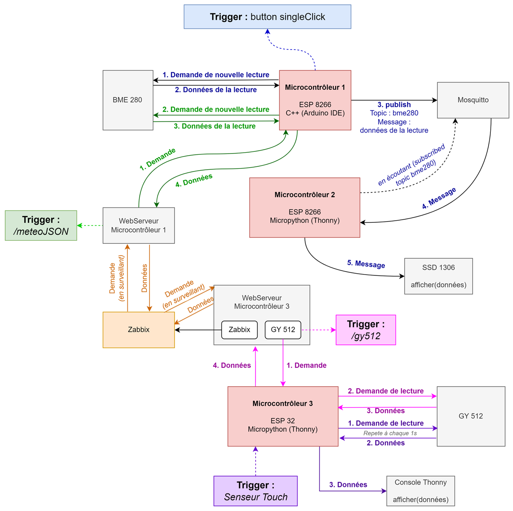
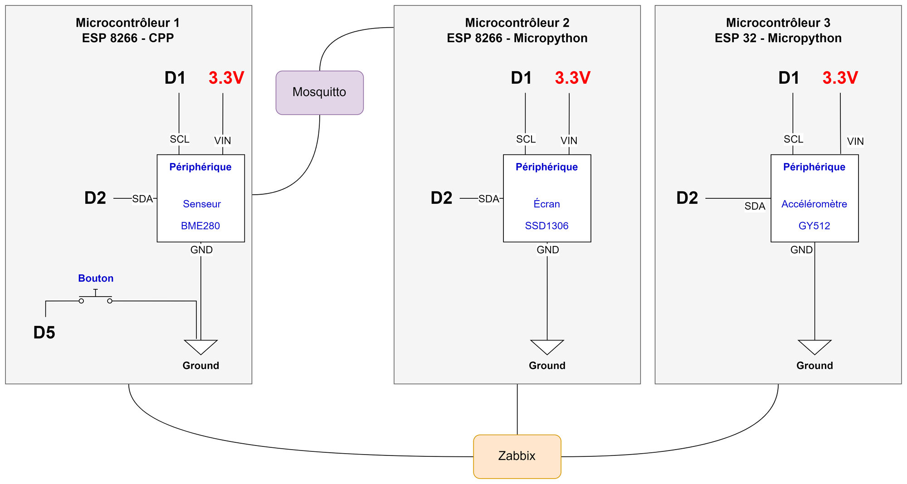

# IoT Sensor Monitoring with MQTT and Zabbix

An academic connected-objects project built for the Institut Grasset IoT course (2022). Three microcontrollers collect and exchange sensor readings, while Mosquitto carries MQTT messages and Zabbix monitors the HTTP/JSON endpoints.

## System overview

- **ESP8266 + Arduino/C++ + BME280:** reads temperature, humidity, pressure, and estimated altitude. It exposes the `/meteoJSON` HTTP endpoint and publishes readings to the `bme280` MQTT topic when its push button is clicked. The sketch also includes Arduino OTA support.
- **ESP8266 + MicroPython + SSD1306 OLED:** subscribes to the `bme280` MQTT topic and displays the received BME280 readings.
- **ESP32 + MicroPython + GY-521 (MPU-6050):** reads accelerometer/gyroscope values and temperature. A touch input triggers readings, and the `dd_web.py` web app exposes them as JSON.
- **Mosquitto:** brokers the MQTT messages between the ESP8266 boards.
- **Zabbix:** monitors BME280 and selected GY-521 measurements through the boards' web endpoints.

## Repository layout

```text
firmware/
├── esp8266-arduino-bme280/       # BME280 HTTP/JSON and MQTT publisher
├── esp8266-micropython-oled/     # MQTT subscriber and OLED display
└── esp32-micropython-gy521/      # GY-521 sensor and MicroPython web server
media/                            # Selected project diagram(s) and demonstration video
```

## Hardware

- 2 × ESP8266 boards
- 1 × ESP32 board
- BME280 environmental sensor
- GY-521 / MPU-6050 accelerometer and gyroscope module
- SSD1306 OLED display
- Push button and touch input
- Mosquitto and Zabbix servers on the local network

## Local configuration

The archive contained Wi-Fi and MQTT credentials plus private LAN addresses. Those values have been removed from the published source and replaced with example settings.

1. For the Arduino board, copy `firmware/esp8266-arduino-bme280/MyWifi.example.h` to `MyWifi.h` in the same folder, then fill in your Wi-Fi and MQTT broker settings.
2. For each MicroPython board, copy its `ssid_info.example.py` to `ssid_info.py` in the same folder and fill in the values for that board. The ESP32 settings also need the Arduino board's `/meteoJSON` URL.
3. Update the Zabbix dashboard link in `firmware/esp32-micropython-gy521/index.html` if you use a Zabbix server.
4. Install the libraries required by the board firmware and configure the Mosquitto and Zabbix services for your lab network.

The `.gitignore` excludes local `MyWifi.h` and `ssid_info.py` files so credentials are not committed accidentally.

## Notes

- This repository documents the school project and its original firmware. Watchdog code in the ESP32 source is commented out and is not active in the submitted application.
- The MQTT client uses the original project protocol settings; review the broker's authentication and transport security before using it outside an isolated lab network.
- `dd_web.py` and `dd_path.py` include upstream-origin and license notes in their source headers.

## Media

### Conceptual architecture



### Electronic wiring



### Demonstration video

[Watch the full project demonstration](media/project-demo.mp4).
